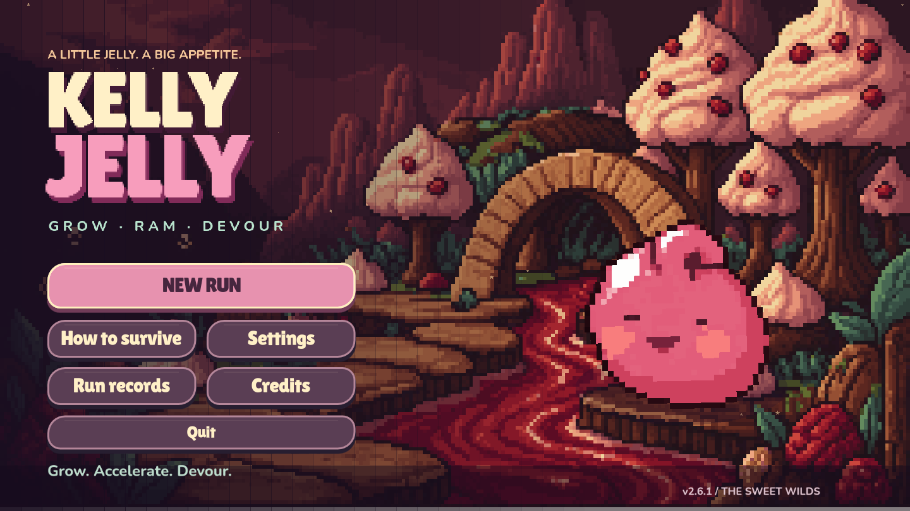
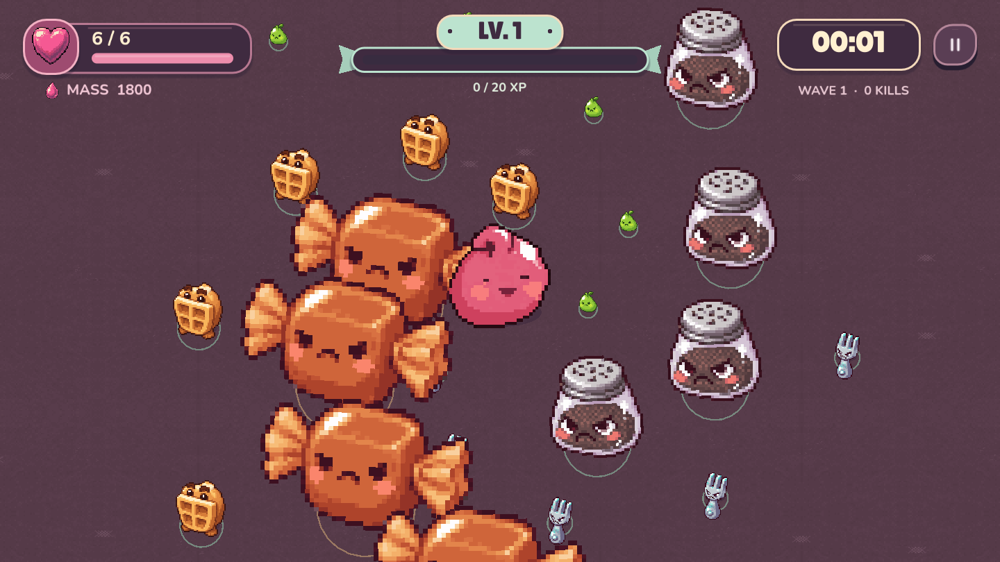
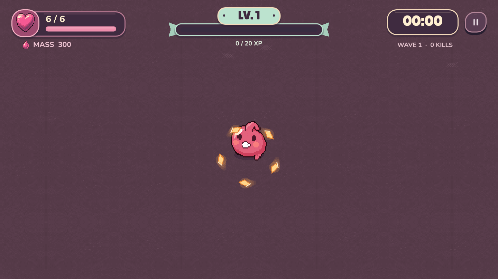
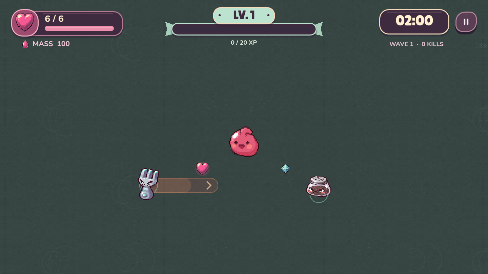
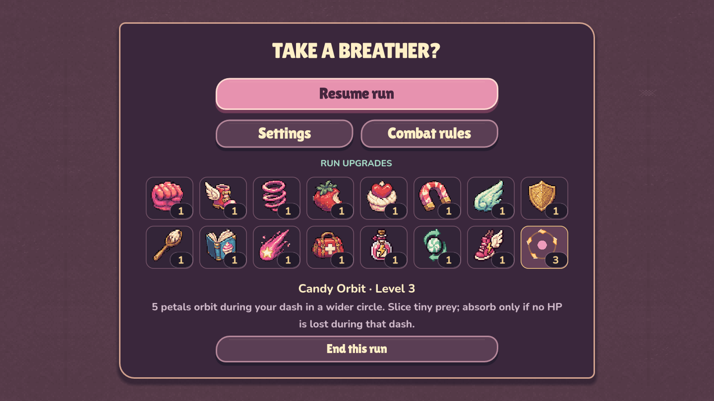
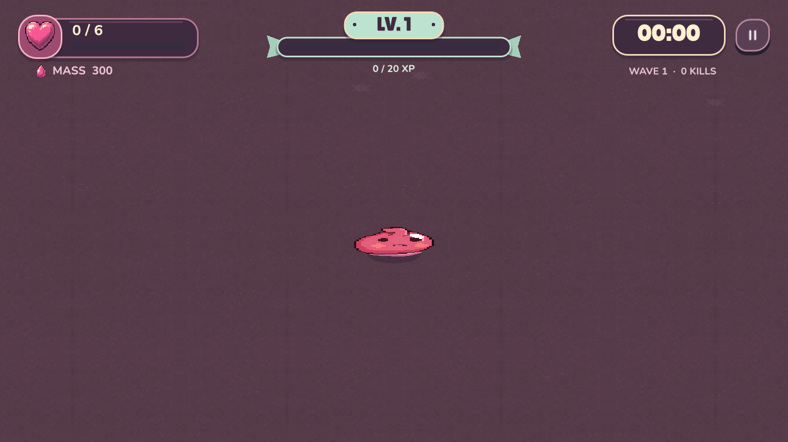

<div align="center">

# Kelly Jelly
### The Sweet Wilds

**Charge. Ram. Absorb. Grow.**

An offline action roguelite about a little jelly growing into the apex predator of a candy world.

**Godot 4.7.2 · Windows x64 · v2.7.5 · English / Russian**

**English** · [Русский](README.ru.md)



[How to play](#how-to-play) · [Gameplay](#gameplay) · [Screenshots](#screenshots) · [Run from source](#run-from-source) · [Road to Steam](#road-to-steam)

</div>

## About the game

Kelly Jelly features endless runs built around a manually aimed ram attack. Charge a dash, pick a direction, and crash into enemies. Your mass and speed determine the impact: small prey can be absorbed, while larger enemies require preparation.

Collect experience to choose upgrades, defeat bosses to unlock Candy Orbit, and grow large enough to change the scale of the fight. Mistakes cost hearts. Lose your last heart and Kelly melts into a puddle — ready for another attempt.

### Current features

- **Mass-and-speed combat.** Charge attacks, directional dashes, a short push, and stamina-based sprinting.
- **Uncapped growth.** Kelly grows and the camera adapts, with gradually diminishing absorption returns.
- **15 repeatable upgrades.** Improve impact, movement, defense, pickup range, experience gain, and stamina.
- **Five regular enemy types and three boss types.** Dashes, volleys, directional shields, and vulnerability windows.
- **Passive Candy Orbit.** Caramel petals circle Kelly during a dash.
- **Progression-based scenery.** The first boss victory turns the terrain mint green; later orbit upgrades unlock caramel and lavender palettes.
- **×1 / ×2 / ×3 game speed.** Speed up combat and the run timer together.
- **Settings and player profile.** English and Russian, volume controls, screen shake, flashes, assists, keyboard remapping, and saved records.

## Project status

**Current version: v2.7.5.** The game is in development and being prepared for Steam. Endless mode is playable. A complete route with a final victory, additional build paths, and more content are planned rather than implemented.

This repository contains **source code, assets, tests, and documentation**. Exported EXE and ZIP files, previous builds, editor caches, and export templates are excluded from Git.

If you already have a local Windows build, launch:

```text
build/windows-v2.7.5/KellyJelly.exe
```

It runs without Godot installed and without an internet connection. To play from this repository, follow the source instructions below: cloning the repository does not download a prebuilt EXE.

## How to play

Select **New run**. Move around, find prey, hold the attack button to charge, then release to dash. Contact is not always safe: enemy mass, Kelly's speed, and enemy defenses all matter.

### Keyboard and mouse

| Action | Controls |
|---|---|
| Move | **WASD** or **arrow keys** |
| Aim | **Mouse** |
| Charge → dash | **Hold LMB → release** |
| Short push | **RMB** or **Space** |
| Stamina-based sprint | **Hold Shift** |
| Game speed | **1 → ×1**, **2 → ×2**, **3 → ×3**; also NumPad |
| Pause | **Esc** |

Keyboard controls can be remapped in settings. Keys 1–3 are reserved for game speed. Sprinting speeds up ordinary movement and does not increase dash speed. Each new run starts at ×1; menus, upgrade selection, and the defeat animation use normal speed.

### Controller

| Action | Controls |
|---|---|
| Move | Left stick |
| Aim | Right stick |
| Charge → dash | **Hold RT → release** |
| Push | **A** |
| Sprint | **LB** |
| Pause | **Start** |

Controller support is implemented in code; a complete test pass on physical devices is still planned. Steam Deck Verified status is not claimed.

## Gameplay

### Clean attacks reward growth

**Mass × speed determines impact strength.** Speed alone cannot bypass the minimum mass threshold. A successful ram damages and knocks back its target; a weak collision can cost a heart even during a dash.

Enemies killed during an attack are absorbed **when that attack ends**, provided Kelly lost no HP during it. Taking damage cancels absorption, but keeps the kill and its experience drop. Dashing does not consume mass.

### Experience and hearts

- **Blue experience** levels Kelly up and offers a choice of three upgrades.
- **Hearts** restore health. They drop every 12 defeats by default and from bosses; upgrades can make them more frequent.
- Hearts remain on the ground while Kelly is at full HP.
- Defeat resets mass and upgrades; records and settings persist.

### Bosses and Candy Orbit

The first boss appears at **1:30 of game time**. Only one boss can be active at a time. Defeating one leaves at least 45 seconds before the next can appear.

| Boss victory | Reward for the rest of the run |
|---|---|
| First | Three caramel petals orbit Kelly during dashes |
| Second | A wider orbit |
| Third | Five petals instead of three |

The orbit slices regular prey with up to 20% of Kelly's mass. Larger targets take a reduced hit governed by mass and speed. Each target can take one orbital hit per dash, independently of a direct ram. Absorption still requires a clean attack.

The waffle's shield protects its front sector: approach from behind or wait for it to open. Boss armor protects bosses outside their vulnerability windows. Warning lanes show enemy dashes; long projectile-volley lanes are hidden to keep combat readable.

## Screenshots

These are actual in-game captures from staged checks of different game states. Some were taken during earlier iterations. They illustrate implemented mechanics rather than promise additional content.

### Growth and combat



### Candy Orbit



### The world after the first boss victory



### Upgrades in the pause menu



### The last heart



## Run from source

### Requirements

- **Godot 4.7.2 stable**, standard edition; .NET is not required.
- **Git** to clone the source.
- **Python 3** only for asset preparation tools and the export-template download helper.

The primary target is Windows x64. Minimum hardware requirements have not yet been established through low-end PC testing. Other platforms are not claimed as tested.

```powershell
git clone https://github.com/sergeyopaic/kelly-jelly.git
cd kelly-jelly
```

Open `project.godot` in Godot, let the assets import, then press **F5** to run the project. **F6** runs the currently selected scene. The project entry point is already configured:

```text
scenes/main.tscn → scripts/run_main.gd
```

If the Godot executable is available as `godot` in your terminal:

```powershell
godot --path .
```

All required game assets are included in the repository. Running the game does not require regenerating images through PixelLab.

### Export for Windows

The **Windows Desktop** preset uses the official export template at:

```text
tools/templates/windows_release_x86_64.exe
```

This binary is not tracked in Git. Obtain the Godot 4.7.2 template manually or use the helper below, which requires internet access:

```powershell
python tools/fetch_template.py
New-Item -ItemType Directory -Force build/windows-v2.7.5
godot --headless --path . --export-release "Windows Desktop" build/windows-v2.7.5/KellyJelly.exe
```

The download helper uses HTTP Range requests. If your network or the server does not support them, download the official export-template archive and place the required EXE at the path above. Before distributing a build, include the required licenses and third-party notices; exporting an EXE is only part of the release process.

## Tests

Run from the project root:

```powershell
# Combat rules, growth, rewards, interface, and saves
godot --headless --path . --script tests/run_survivors_tests.gd

# Actual time scaling at ×1 / ×2 / ×3
godot --headless --path . --script tests/run_speed_tests.gd

# Extended combat simulation
godot --headless --path . --script tests/stress_survivors.gd
```

Version v2.7.5 has **228 passing deterministic checks**, plus a separate verification of actual game-speed scaling. Tests use separate profiles. Automated checks do not replace human playtests, physical controller testing, or performance measurements on minimum-spec hardware.

Details: [v2.7.5 QA](docs/QA_V275.md), [defeat animation](docs/QA_V274.md), and [Candy Orbit](docs/QA_V27.md).

## Project layout

| Path | Purpose |
|---|---|
| `scenes/main.tscn` | Current main scene |
| `scripts/run_main.gd` | Menus, HUD, input, upgrade selection, and game speed |
| `scripts/run_arena.gd` | Combat, growth, spawning, rewards, and run state |
| `scripts/run_enemy.gd` | Regular enemy and boss behavior |
| `scripts/run_art.gd` | World rendering, warnings, and effects |
| `scripts/kelly_emotions.gd` | Animation states and Kelly's melting animation |
| `scripts/profile.gd` | Settings, records, and profile recovery |
| `data/run_rules.gd` | Formulas and 15 upgrades |
| `assets/` | Graphics, fonts, music, and sound effects |
| `tests/` | Rule checks and simulations |
| `tools/` | Asset, audio, and export-template preparation |
| `docs/` | QA reports, design history, and the release plan |

The older campaign scripts, `main.gd` and `arena.gd`, are retained for historical reference. They are not the current game. Work on the `run_*` files when changing the active gameplay.

### Saves and version history

The profile lives at `user://profile.json`, in Godot's application data directory. It stores settings and records. **Resuming an unfinished run is not yet implemented.**

Source history is tracked in Git. Build binaries and ZIP archives are stored separately. The initial v2.7.5 snapshot is tagged `v2.7.5-baseline`. See the [Git workflow guide, in Russian](docs/GIT_WORKFLOW.md).

## Road to Steam

The next steps are external playtests, distinct build paths, a complete run structure, and store and release preparation. These are proposals, **not features already implemented**.

The following planning materials are currently in Russian:

- [Detailed audit and development plan](docs/steam-readiness-2026-11-07/output/STEAM_READINESS_PLAN_RU.md)
- [Prioritized backlog and release checklist](docs/steam-readiness-2026-11-07/output/BACKLOG_AND_RELEASE_CHECKLIST_RU.md)
- [PowerPoint presentation — 23 slides](docs/steam-readiness-2026-11-07/output/Kelly-Jelly-Steam-Plan.pptx)
- [Offline HTML presentation](docs/steam-readiness-2026-11-07/output/Kelly-Jelly-Steam-Readiness.html) — download the file and open it in a browser

Report bugs and suggest improvements through [Issues](https://github.com/sergeyopaic/kelly-jelly/issues). Include the build version, input device, reproduction steps, and a screenshot or video. Add the run seed if available.

## Art, audio, and licensing

Character art and part of the environment were created using **PixelLab**. Interface elements, effects, and asset processing are implemented in the project; music and sound effects are synthesized by the included tools. Fonts are **Lilita One, Nunito, and Inter**, with their OFL texts alongside the font files in `assets/fonts/`.

- [Asset credits, in Russian](docs/ASSET_CREDITS.md)
- [Original art manifest](assets/manifest.json)
- [Animation manifest](assets/emotions/manifest.json)
- [Visual asset manifest](assets/visuals/manifest.json)

Godot is distributed under the MIT license. The game's own code and artwork do not automatically inherit that license. A project-wide license has not yet been declared. Asset rights and third-party license notices must be reviewed before commercial release.
