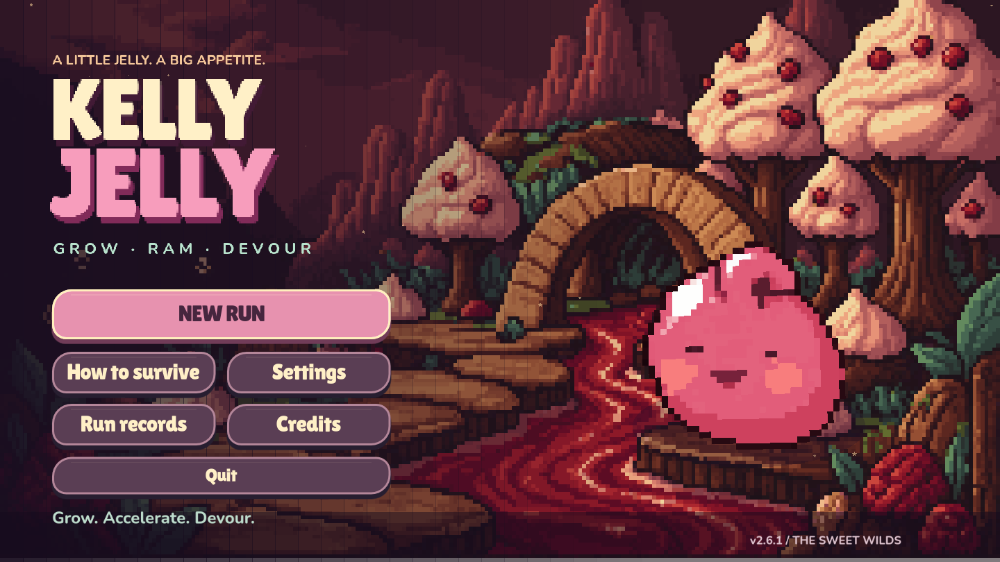
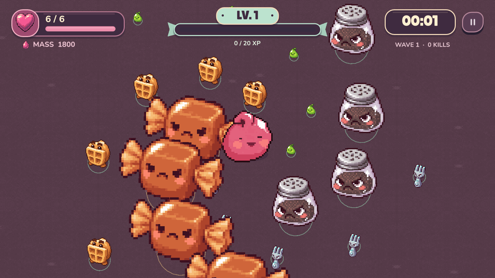
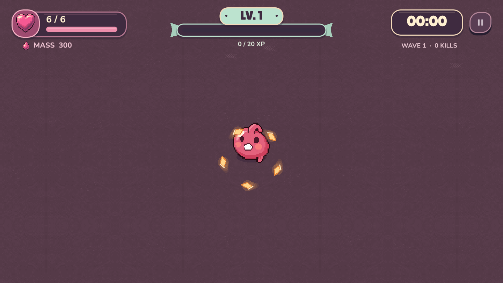
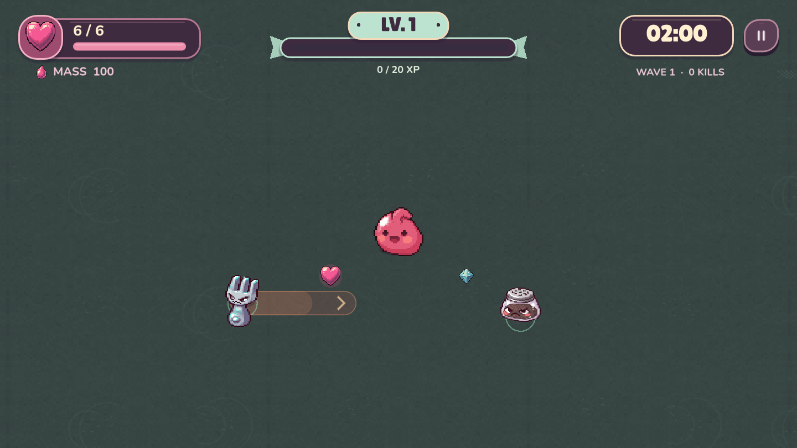
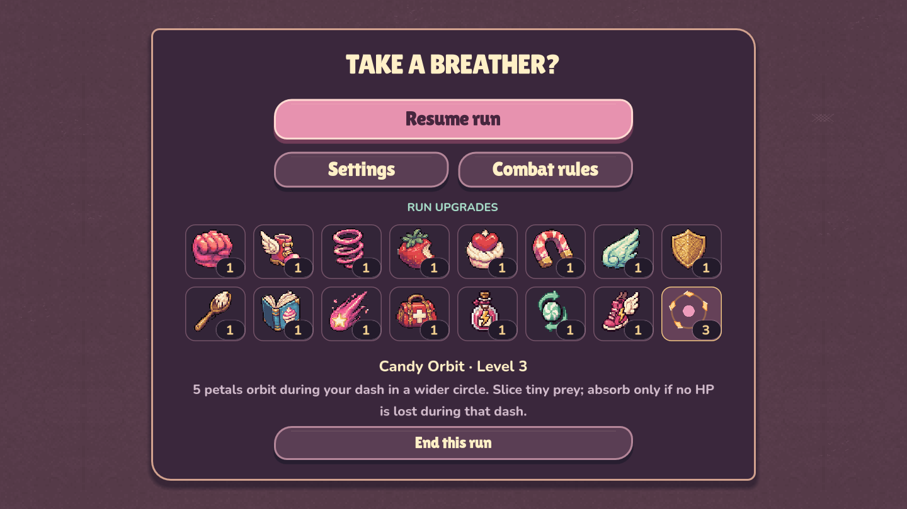
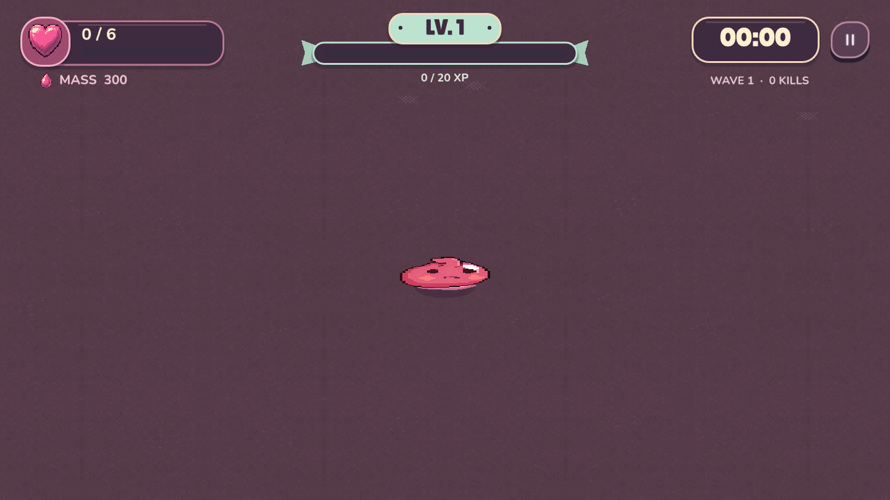

<div align="center">

# Kelly Jelly
### The Sweet Wilds

**Разгонись. Протарань. Поглоти. Вырасти.**

Офлайн action roguelite о маленькой желешке, которая становится главным хищником сладкого мира.

**Godot 4.7.2 · Windows x64 · v2.7.5 · English / Русский**

[English](README.md) · **Русский**



[Как играть](#как-играть) · [Механики](#механики) · [Скриншоты](#скриншоты) · [Запуск из исходников](#запуск-из-исходников) · [Подготовка к Steam](#подготовка-к-steam)

</div>

## Об игре

Kelly Jelly — бесконечные забеги с ручным управлением атакой. Келли заряжает рывок, выбирает направление и врезается во врагов. Сила удара зависит от массы и скорости: маленькую добычу можно поглотить, а к более крупной нужно подготовиться.

Опыт открывает улучшения, победы над боссами дают карамельную орбиту, а растущее тело меняет масштаб боя. Ошибка стоит сердца. Потеря последней жизни превращает Келли в лужицу — и начинается новая попытка.

### Что уже работает

- **Таран массой и скоростью.** Заряд, направленный дэш, короткий толчок и спринт с выносливостью.
- **Рост без игрового потолка.** Келли увеличивается, камера адаптируется; отдача от поглощения постепенно снижается.
- **15 повторяемых улучшений.** Урон, движение, защита, сбор предметов, опыт и выносливость.
- **Пять обычных типов врагов и три типа боссов.** Рывки, залпы, направленный щит и окна уязвимости.
- **Пассивная Candy Orbit.** Карамельные лепестки вращаются вокруг Келли во время дэша.
- **Окружение по прогрессу.** После первого босса фон становится мятным; развитие орбиты открывает карамельную и лавандовую палитры.
- **Скорость игры ×1 / ×2 / ×3.** Ускоряется весь бой вместе с игровым таймером.
- **Настройки и профиль.** Английский и русский языки, громкость, тряска, вспышки, помощь, перепривязка клавиш и сохранение рекордов.

## Статус проекта

**Текущая версия — v2.7.5.** Игра находится в разработке и подготовке к Steam. Реализован бесконечный режим; законченный маршрут с финальной победой, новые сборки и расширение контента пока относятся к плану развития.

В репозитории находятся **исходники, ассеты, тесты и документация**. Готовые EXE и ZIP, старые сборки, кэш редактора и экспортные шаблоны исключены из Git.

Если у вас уже есть локальная Windows-сборка, откройте:

```text
build/windows-v2.7.5/KellyJelly.exe
```

Она работает без установки Godot и без интернета. Для получения игры из этого репозитория используйте инструкцию ниже: клонирование само по себе не скачивает EXE.

## Как играть

Выберите **New run**. Двигайтесь, найдите добычу, зажмите кнопку атаки для заряда и отпустите её для рывка. Не каждый контакт безопасен: размер врага, скорость Келли и состояние защиты имеют значение.

### Клавиатура и мышь

| Действие | Управление |
|---|---|
| Движение | **WASD** или **стрелки** |
| Направление атаки | **Мышь** |
| Заряд → дэш | **Зажать ЛКМ → отпустить** |
| Короткий толчок | **ПКМ** или **Пробел** |
| Спринт с выносливостью | **Удерживать Shift** |
| Скорость игры | **1 → ×1**, **2 → ×2**, **3 → ×3**; также NumPad |
| Пауза | **Esc** |

Клавиши можно изменить в настройках. Цифры 1–3 зарезервированы для скорости игры. Спринт ускоряет обычный бег и не усиливает скорость дэша. Каждый новый забег начинается на ×1; меню, выбор улучшений и анимация поражения идут с обычной скоростью.

### Геймпад

| Действие | Управление |
|---|---|
| Движение | Левый стик |
| Направление атаки | Правый стик |
| Заряд → дэш | **RT → отпустить** |
| Толчок | **A** |
| Спринт | **LB** |
| Пауза | **Start** |

Поддержка геймпада реализована в коде; полный прогон на физических устройствах ещё входит в план проверки. Steam Deck Verified не заявлен.

## Механики

### Чистая атака даёт рост

**Масса × скорость определяют силу удара.** Одной скорости недостаточно, чтобы преодолеть минимальный порог массы. Удачный таран ранит и отбрасывает цель; слабое столкновение может снять сердце даже во время дэша.

Убитые за атаку враги поглощаются **после её завершения**, если Келли за эту атаку не потеряла HP. Полученный урон отменяет поглощение, но не убийство и не выпавший опыт. Масса при рывке не расходуется.

### Опыт и сердца

- **Голубой опыт** повышает уровень и открывает выбор одного из трёх улучшений.
- **Сердца** лечат. Базово они выпадают каждые 12 побед и с боссов; улучшения могут повысить частоту.
- При полном HP сердца остаются на земле.
- После поражения масса и улучшения сбрасываются; рекорды и настройки сохраняются.

### Боссы и карамельная орбита

Первый босс появляется на **1:30 игрового времени**. Одновременно активен только один босс. После его поражения есть минимум 45 секунд до следующего.

| Победа над боссом | Награда до конца забега |
|---|---|
| Первая | Три карамельных лепестка вращаются вокруг Келли во время дэша |
| Вторая | Орбита становится шире |
| Третья | Число лепестков увеличивается до пяти |

Орбита разрубает обычную добычу массой до 20% массы Келли, а более крупным целям наносит ослабленный удар по правилам массы и скорости. Одна цель получает одно попадание орбитой за дэш, отдельно от прямого тарана. Поглощение по-прежнему требует чистой атаки.

Щит вафли закрывает передний сектор: заходите сзади или дождитесь раскрытия. Броня босса защищает его вне окна уязвимости. Полосы предупреждают о вражеских дэшах; длинные траектории залпов скрыты для читаемости боя.

## Скриншоты

Ниже — реальные снимки игры из постановочных проверок разных состояний. Часть кадров снята на промежуточных версиях; это иллюстрации текущих механик, а не обещание дополнительного контента.

### Рост и бой



### Карамельная орбита



### Мир после первой победы над боссом



### Улучшения в паузе



### Последнее сердце



## Запуск из исходников

### Что понадобится

- **Godot 4.7.2 stable**, стандартная версия; .NET не требуется.
- **Git** для получения исходников.
- **Python 3** — только для вспомогательных генераторов и загрузки экспортного шаблона.

Основная целевая платформа — Windows x64. Минимальные системные требования ещё не зафиксированы замерами на слабых ПК. Запуск на других платформах не заявлен как проверенный.

```powershell
git clone https://github.com/sergeyopaic/kelly-jelly.git
cd kelly-jelly
```

Откройте `project.godot` в Godot, дождитесь импорта ассетов и нажмите **F6** для выбранной сцены либо **F5** для запуска проекта. Главная сцена уже настроена:

```text
scenes/main.tscn → scripts/run_main.gd
```

Можно запустить из терминала, если исполняемый файл Godot доступен под именем `godot`:

```powershell
godot --path .
```

Все необходимые игровые ассеты сохранены в репозитории. Повторная генерация изображений через PixelLab для обычного запуска не нужна.

### Windows-экспорт

Текущий preset **Windows Desktop** использует официальный шаблон:

```text
tools/templates/windows_release_x86_64.exe
```

Он не хранится в Git. Получите шаблон Godot 4.7.2 вручную либо вспомогательным скриптом, которому нужен интернет:

```powershell
python tools/fetch_template.py
New-Item -ItemType Directory -Force build/windows-v2.7.5
godot --headless --path . --export-release "Windows Desktop" build/windows-v2.7.5/KellyJelly.exe
```

Скрипт загрузки использует HTTP Range; если сервер или сеть не поддерживают такие запросы, скачайте официальный комплект экспортных шаблонов и поместите нужный EXE по указанному пути. Для распространения подготовьте также необходимые лицензии и notices — один экспорт EXE не закрывает весь процесс выпуска.

## Проверки

Из корня проекта:

```powershell
# Правила боя, рост, награды, интерфейс и сохранения
godot --headless --path . --script tests/run_survivors_tests.gd

# Фактическая скорость времени для ×1 / ×2 / ×3
godot --headless --path . --script tests/run_speed_tests.gd

# Длительная симуляция боя
godot --headless --path . --script tests/stress_survivors.gd
```

Для v2.7.5 зафиксированы **228 успешных детерминированных проверок** и отдельная проверка реального ускорения времени. Тесты используют отдельные профили. Автоматические проверки не заменяют человеческий плейтест, проверку геймпада и измерение производительности на минимальной конфигурации.

Подробности: [QA v2.7.5](docs/QA_V275.md), [таяние при поражении](docs/QA_V274.md), [орбита](docs/QA_V27.md).

## Устройство проекта

| Путь | Назначение |
|---|---|
| `scenes/main.tscn` | Актуальная главная сцена |
| `scripts/run_main.gd` | Меню, HUD, ввод, выбор улучшений, скорость игры |
| `scripts/run_arena.gd` | Бой, рост, спавн, награды и состояние забега |
| `scripts/run_enemy.gd` | Поведение обычных врагов и боссов |
| `scripts/run_art.gd` | Отрисовка мира, предупреждений и эффектов |
| `scripts/kelly_emotions.gd` | Анимационные состояния и таяние Келли |
| `scripts/profile.gd` | Настройки, рекорды и восстановление профиля |
| `data/run_rules.gd` | Формулы и 15 улучшений |
| `assets/` | Игровая графика, шрифты, музыка и звуки |
| `tests/` | Проверки правил и симуляции |
| `tools/` | Подготовка ассетов, аудио и экспортного шаблона |
| `docs/` | QA, история решений и план выпуска |

Старые скрипты кампании `main.gd` и `arena.gd` сохранены для истории. Они не являются актуальной игрой; при изменении механик ориентируйтесь на файлы `run_*`.

### Сохранения

Профиль находится в `user://profile.json`, в системной папке данных приложения Godot. Он хранит настройки и рекорды. **Продолжение незаконченного забега пока не реализовано.**

История исходников ведётся в Git. Сборки и ZIP хранятся отдельно; исходный снимок v2.7.5 отмечен тегом `v2.7.5-baseline`. Подробнее: [порядок работы с Git](docs/GIT_WORKFLOW.md).

## Подготовка к Steam

Следующий этап — проверить игру на внешних игроках, развить разные сборки и законченный маршрут, затем подготовить страницу и релизный процесс. Эти предложения **не являются уже реализованными функциями**.

- [Подробный аудит и план развития](docs/steam-readiness-2026-11-07/output/STEAM_READINESS_PLAN_RU.md)
- [Backlog с приоритетами и проверками выпуска](docs/steam-readiness-2026-11-07/output/BACKLOG_AND_RELEASE_CHECKLIST_RU.md)
- [Презентация PowerPoint — 23 слайда](docs/steam-readiness-2026-11-07/output/Kelly-Jelly-Steam-Plan.pptx)
- [Офлайн-презентация HTML](docs/steam-readiness-2026-11-07/output/Kelly-Jelly-Steam-Readiness.html) — скачайте файл и откройте в браузере

Задачи и найденные проблемы можно оставлять в [Issues](https://github.com/sergeyopaic/kelly-jelly/issues). Для воспроизведения ошибки укажите версию сборки, управление, шаги и приложите снимок или видео; если виден seed забега, добавьте его.

## Арт, звук и лицензии

Графика персонажей и часть окружения созданы с помощью **PixelLab**. Интерфейс, эффекты и обработка ассетов реализованы в проекте; музыка и звуки синтезируются вспомогательными скриптами. Шрифты — **Lilita One, Nunito и Inter**; тексты OFL находятся рядом с файлами в `assets/fonts/`.

- [Происхождение ассетов](docs/ASSET_CREDITS.md)
- [Манифест исходной графики](assets/manifest.json)
- [Манифест анимаций](assets/emotions/manifest.json)
- [Манифест визуального оформления](assets/visuals/manifest.json)

Godot распространяется по MIT; это не означает, что собственный код игры и её изображения автоматически имеют ту же лицензию. Общая лицензия проекта пока не объявлена. Перед коммерческим выпуском требуется завершить проверку прав на ассеты и комплекта сторонних лицензий.
